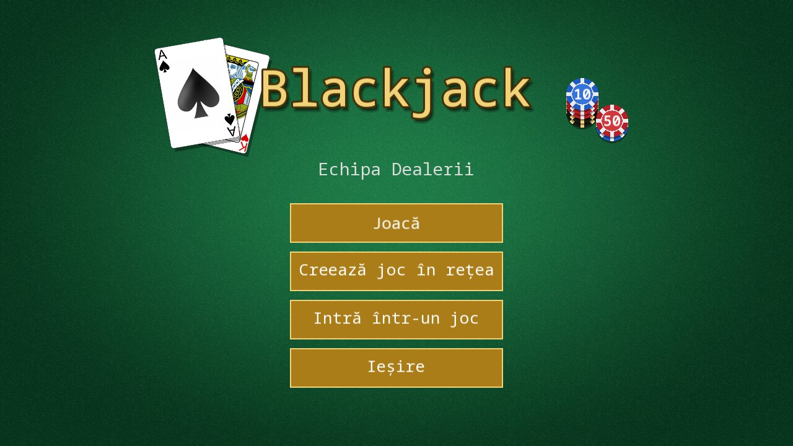
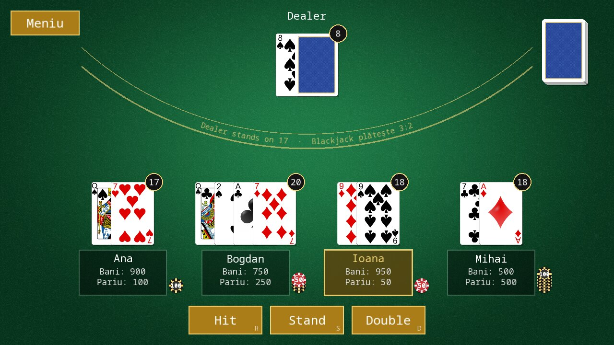

# Blackjack Multiplayer

Joc de blackjack pentru 1–4 jucători, în C++23 cu SFML 3. Se poate juca la același calculator,
pe rând, sau în rețea, fiecare de pe calculatorul lui.

Proiect pentru Inginerie Software, echipa **Dealerii**.

| Meniu | Masa |
|---|---|
|  |  |

## Ce știe jocul

- 1–4 jucători la același calculator, pe rând, sau 2–4 în rețea locală, câte unul pe calculator
- pariuri cu jetoane (minim 10, maxim 500), Hit, Stand, Double
- dealerul trage până la 17; blackjack plătește 3:2, câștigul 1:1, egalul își păstrează pariul
- animații pentru cărți și jetoane, sunete, ecran de rezultat după fiecare rundă
- fereastră redimensionabilă și ecran complet (F11)

## Cum se compilează și se pornește

Codul e în folderul `game/`. SFML și celelalte biblioteci se descarcă singure la prima
configurare (prin CPM), deci prima dată durează câteva minute.

### Windows (Visual Studio)

1. Deschide folderul `game/` în Visual Studio (File → Open → Folder).
2. Așteaptă să se termine configurarea CMake și alege presetul **x64 Debug (MSVC)**.
3. Alege ținta **Frontend.exe (Install)** și apasă **F5**.

Din linie de comandă („x64 Native Tools Command Prompt for VS”):

```bat
cd game
cmake --preset x64-debug
cmake --build --preset x64-debug
out\install\x64-debug\bin\Frontend.exe
```

### Linux

Trebuie: `clang`, `cmake`, `ninja` și bibliotecile de dezvoltare pentru fereastră folosite de
SFML. Pe Fedora:

```bash
sudo dnf install clang cmake ninja-build libX11-devel libXrandr-devel libXcursor-devel \
    libXi-devel mesa-libGL-devel systemd-devel
```

Apoi:

```bash
cd game
cmake --preset x64-debug-clang
cmake --build --preset x64-debug-clang
cd out/install/x64-debug-clang/bin && ./Frontend
```

Jocul se pornește din folderul în care e executabilul, altfel nu își găsește `assets/`
(cărțile, fontul). După un `git pull` care aduce fișiere noi, rulați din nou
`cmake --preset ...`, nu doar build-ul.

## Cum se joacă

**La același calculator:** Meniu → **Joacă** → adaugă 1–4 jucători → **Start**.

**În rețea** (același Wi-Fi sau cablu):
- un calculator e gazda: Meniu → **Creează joc în rețea** → numele → **Creează**. Pe ecran
  apare adresa (ex. `192.168.1.5`);
- ceilalți: Meniu → **Intră într-un joc** → numele și adresa gazdei → **Conectează-te**;
- gazda apasă **Start** când au intrat toți.

Firewall-ul gazdei trebuie să permită portul 53000 (Windows întreabă singur; pe Fedora:
`sudo firewall-cmd --add-port=53000-53009/tcp`). Detalii în
[`docs/joc-in-retea`](docs/joc-in-retea/README.md).

| Tastă | Ce face |
|---|---|
| H / S / D | Hit / Stand / Double (sau butoanele de pe masă) |
| Enter | Confirmă pariul; „Runda următoare” pe ecranul de rezultat |
| Backspace | Șterge pariul |
| Escape | Înapoi la meniu |
| M | Sunet oprit / pornit |
| F11 | Ecran complet |

## Cum e organizat

```
game/
├── Backend/    logica jocului și jocul în rețea (bibliotecă dinamică, fără grafică)
│   ├── include/Backend/       API-ul: interfețe (IGame, IGameListener, IPlayer, IDeck,
│   │                          INetworkHost, INetworkClient, ...), enum-uri, Card
│   ├── include/Backend/game/  implementarea jocului (Game, Player, Dealer, Deck)
│   └── include/Backend/net/   implementarea rețelei (NetworkHost, NetworkClient, RemoteGame, ...)
├── Frontend/   interfața grafică (SFML): ecrane, masa, animații, sunete
└── cmake/      dependențele (SFML)
```

- **Backend**-ul expune doar interfețe și enum-uri; jocul se creează cu `IGame::Produce()`,
  iar cel în rețea cu `INetworkHost::Produce()` / `INetworkClient::Produce()`.
- **Frontend**-ul nu conține reguli de joc: masa arată ce îi spune jocul și îl întreabă ce e
  permis (`CanPlaceBet`, `CanDoubleDown`, `IsBusted`).
- **Unit testele** (GoogleTest + GoogleMock) vor fi al treilea proiect, `game/Tests`.

### Design patterns

| Pattern | Unde |
|---|---|
| **Observer** | `IGameListener`: jocul anunță tot ce se schimbă, iar masa (prin `GameController`) și rețeaua (`EventEncoder`) ascultă; `INetworkListener` pentru lobby-ul din rețea |
| **Factory Method** | `IGame::Produce()`, `INetworkHost::Produce()`, `INetworkClient::Produce()` |
| **Proxy** | `RemoteGame`: pe calculatorul unui jucător din rețea ține locul jocului gazdei, cu aceeași interfață `IGame` |
| **Decorator** | `HostedGame`: jocul real al gazdei, care în plus anunță rețeaua când nu mai poate porni nicio rundă |
| **Adapter** | `GameController`: traduce anunțurile jocului în funcțiile mesei |
| **State** | ecranele aplicației (`Screen`, `ScreenManager`) |
| **Strategy** | `GameSession`: masa primește jocul local (`LocalSession`) sau din rețea (`NetworkSession`) |

## Documentație

| | |
|---|---|
| [`docs/uml`](docs/uml/README.md) | Use Case Diagram și Class Diagrams (jocul și jocul în rețea) |
| [`docs/frontend-ecrane`](docs/frontend-ecrane/README.md) | Ecranele, masa și legătura cu jocul |
| [`docs/frontend-componente`](docs/frontend-componente/README.md) | Componentele de desen: cărți, jetoane, fundal, sunete |
| [`docs/joc-in-retea`](docs/joc-in-retea/README.md) | Jocul în rețea: cum se joacă și cum funcționează |
| [`documentatie_programatori.pdf`](documentatie_programatori.pdf) | Reguli de cod și cum se deschide proiectul în Visual Studio / VS Code |

Cărțile sunt din setul public domain al lui Byron Knoll (vezi
`game/Frontend/assets/cards/CREDITS.txt`).
