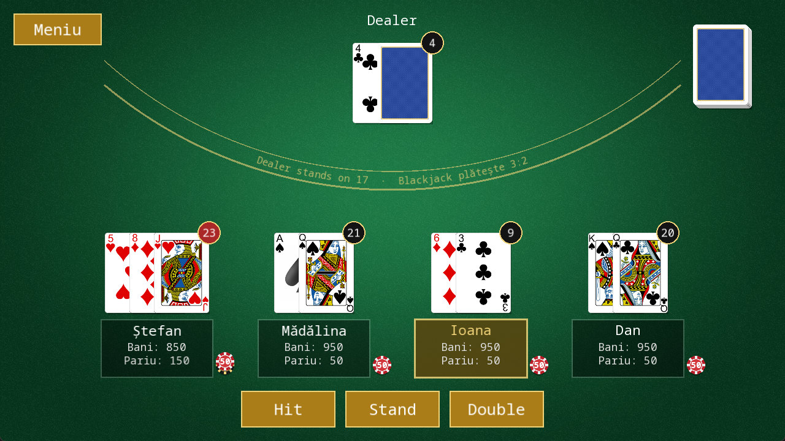
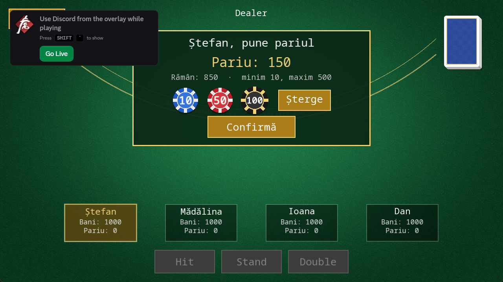
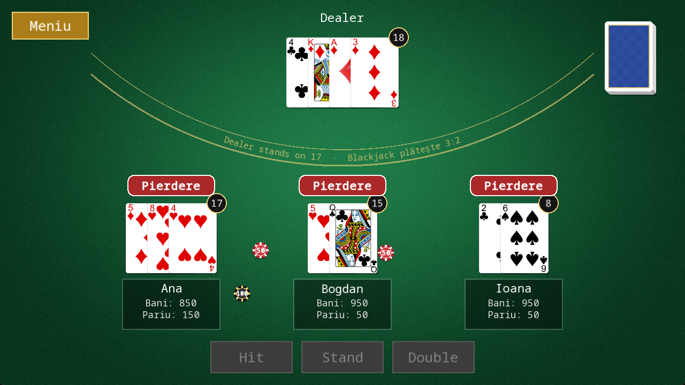
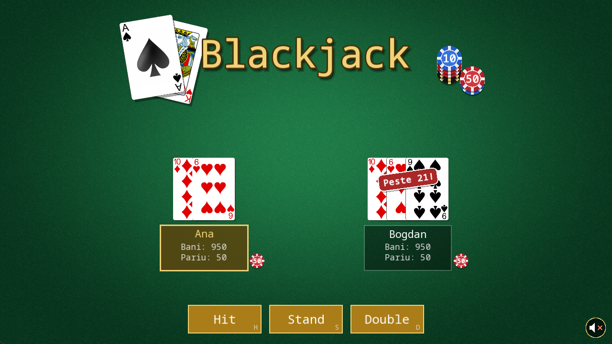
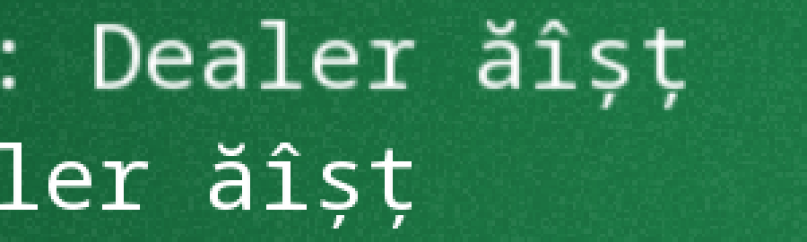

# Componente Frontend: cărți, mâini, locuri, jetoane, fundal, sunete

Toate componentele sunt în `game/Frontend` (header-ele în `include/`, sursele în `src/`), în
namespace-ul `Frontend`. Se desenează în spațiul logic 1280×720, ca restul ecranelor.

## Cărți și mâini

| Componentă | Fișier | Ce face |
|---|---|---|
| **CardTextures** | `ui/card_textures.h` | Încarcă o singură dată cele 52 de imagini + spatele din `assets/cards/` și le dă prin `get(rank, suit)` și `back()`. Rang 2–14 (11 J, 12 Q, 13 K, 14 A), culori `kSuitClubs/Diamonds/Hearts/Spades`. Dacă lipsește o imagine, scrie eroarea în consolă și aplicația se oprește. Ajunge la ecrane prin `AppContext::cards`. |
| **CardView** | `ui/card_view.h` | O carte de 90×131, cu fața sau cu spatele în sus, cu umbră ușoară. Știe să alunece (`moveTo`, cu întârziere) și să se întoarcă animat (`flip`). Poate fi și „necunoscută” (cartea ascunsă a dealerului), până la `setCard`. |
| **HandView** | `ui/hand_view.h` | Cărțile unei mâini, suprapuse și centrate. `dealCard` aduce cartea din pachet cu animație și sunet, `revealCard` întoarce cartea ascunsă, `shake` scutură mâna. |
| **SeatView** | `ui/seat_view.h` | Locul unui jucător: mâna, panoul cu nume, bani și pariu, plus teancul de jetoane. Locul celui la rând e evidențiat (`setActive`). Banii se numără treptat (`setMoney`), jetoanele zboară la final de rundă (`settleBet`), iar `showBust` scutură mâna și pune eticheta „Peste 21!”. |

## Jetoane și pariuri

| Componentă | Fișier | Ce face |
|---|---|---|
| **ChipView** | `ui/chip_view.h` | Un jeton rotund cu valoarea pe el: 10 albastru, 50 roșu, 100 negru cu auriu. |
| **ChipButton** | `ui/chip_button.h` | Jeton apăsabil (hover, apăsare, dezactivat). Click-ul contează doar în cerc. |
| **ChipStack** | `ui/chip_stack.h` | Teancul unui pariu, împărțit în jetoane de 100/50/10. La final de rundă zboară spre jucător sau spre dealer (`sendTo`). |
| **BettingPanel** | `ui/betting_panel.h` | Panoul de pariu (al colegului), acum cu jetoane rotunde în loc de butoanele +10/+50/+100. |

## Masa, meniul și rezultatul

| Componentă | Fișier | Ce face |
|---|---|---|
| **FeltBackground** | `ui/felt_background.h` | Postavul verde cu gradient și textură fină, pe tot ecranul. Fundal comun pentru meniu, lobby și masă. |
| **TableBackground** | `ui/table_background.h` | Postavul + arcul auriu + textul „Dealerul se oprește la 17 · Blackjack plătește 3:2” scris de-a lungul arcului. |
| **TitleBanner** | `ui/title_banner.h` | Titlul „Blackjack” din meniu, auriu cu umbră, cu un evantai de cărți (A♠, K♥) care se leagănă și un teanc de jetoane. |
| **ResultBadge** | `ui/result_badge.h` | Eticheta cu rezultatul („Câștig”, „Pierdere”, „Egal”, „Blackjack!”), care crește și se așază la apariție. La câștig se aude sunetul de victorie. |

## Stil și text clar

- **Theme** (`ui/theme.h`): toate culorile (auriu, verdele postavului, roșu, culorile butoanelor)
  și mărimile de text într-un singur loc.
- **drawText** (`ui/crisp_text.h`): se folosește în loc de `target.draw(text)`. Pe ecran complet
  (F11) literele sunt generate direct la rezoluția reală a ecranului, deci textul rămâne clar
  (nu se întinde ca o imagine).
- **Button::setHint** (`ui/button.h`): o literă mică în colțul butonului, ex. tasta H pe „Hit”.

Sus: text desenat normal, întins la ecran complet (încețoșat). Jos: același text cu `drawText`.

## Sunete și fereastră

- **SoundPlayer** (`audio/sound_player.h`): sunete pentru cărți, jetoane și câștig. Sunt generate
  din cod la pornire (zgomot și tonuri sintetizate), nu din fișiere, deci nu există probleme de
  licență. Oriunde în cod: `playSound(SoundId::Card)`.
- **Tasta M** oprește/pornește sunetul; cât e oprit, în colțul din dreapta-jos apare
  **MuteIcon** (`ui/mute_icon.h`). În lobby, M se poate scrie în nume fără să oprească sunetul
  (ecranul anunță prin `Screen::isTypingText()` că se scrie text).
- **F11**: ecran complet / fereastră.
- **Iconița ferestrei**: asul de pică.
