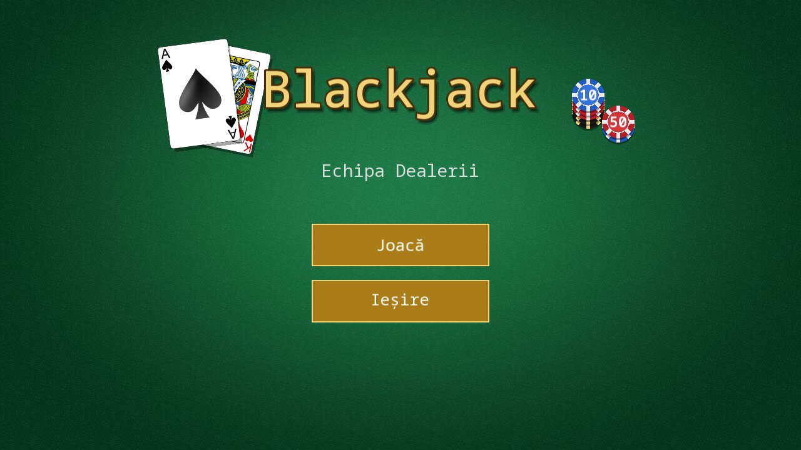
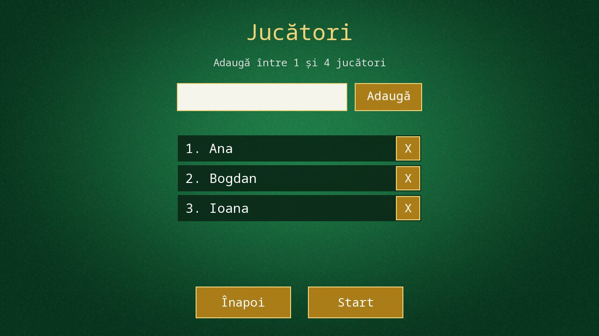
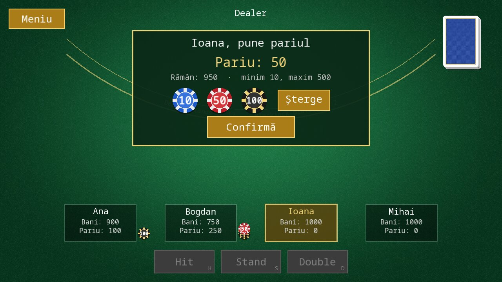
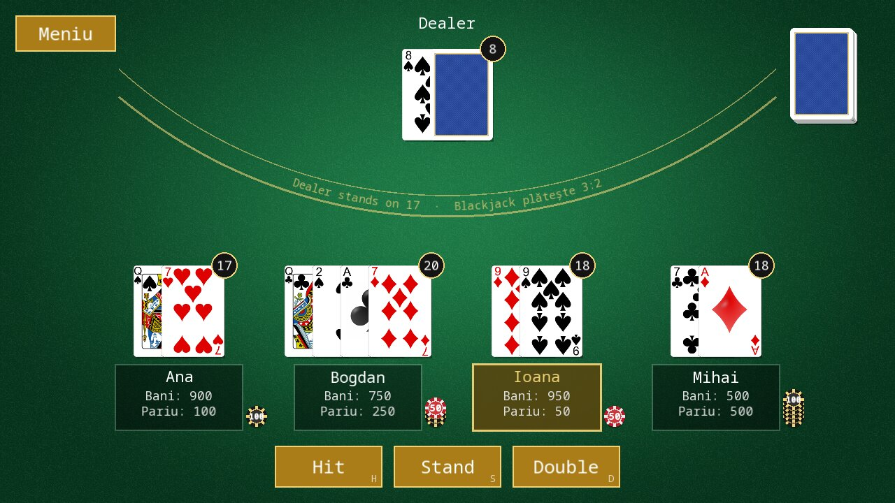
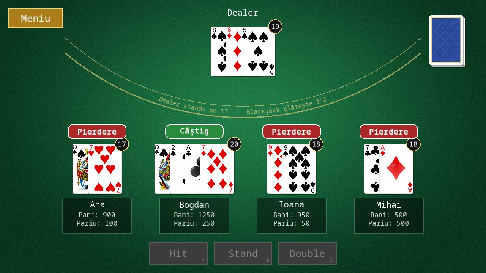
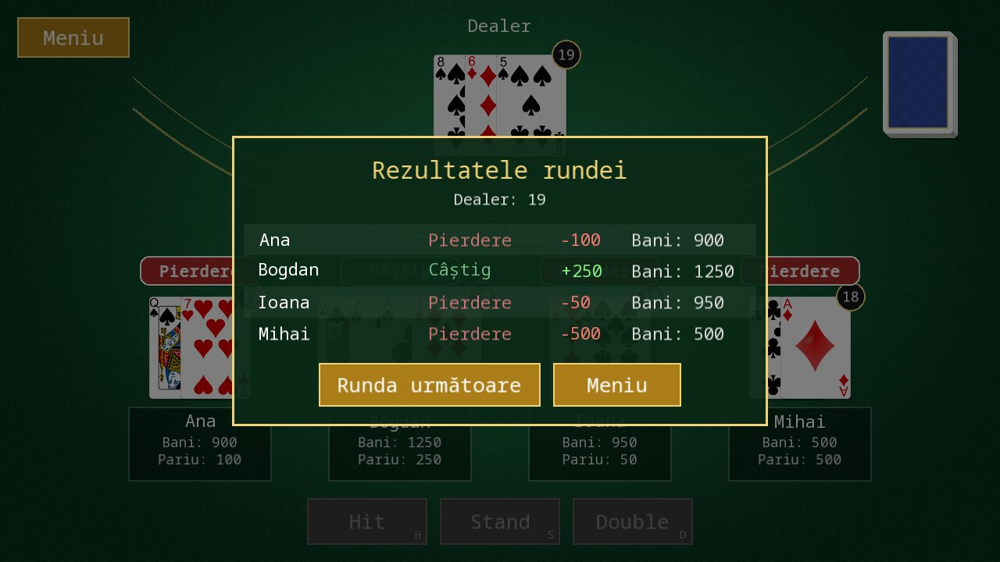

# Frontend: ecrane, masa și legătura cu jocul

Ecranele aplicației, funcțiile prin care jocul controlează masa și `GameController`, legătura
dintre masă și jocul din Backend. Componentele de desen (cărți, mâini, locuri, jetoane, fundal,
sunete) sunt descrise separat, în [`frontend-componente`](../frontend-componente/README.md).

Tot codul e în `game/Frontend` (header-ele în `include/`, sursele în `src/`), în namespace-ul
`Frontend`.

## Cum se trece de la un ecran la altul

```
Meniu ──Joacă──▶ Lobby ──Start──▶ Masă
  ▲               │                │
  └────Înapoi─────┘                │
  ▲                                │
  └──────────Meniu / Escape────────┘

La masă, fiecare rundă:
  pariuri (pe rând) ─▶ împărțire ─▶ rândul jucătorilor ─▶ dealerul ─▶ rezultate
        ▲                                                                │
        └──────────── ecranul de rezultat: „Runda următoare” ◀───────────┘
```

| Ecran | Fișier | Ce face |
|---|---|---|
| **MenuScreen** | `screens/menu_screen.h` | Titlul animat, „Joacă” (spre lobby) și „Ieșire”. |
| **LobbyScreen** | `screens/lobby_screen.h` | Se adaugă 1–4 jucători, cu nume de maxim 12 caractere (diacriticele merg). Numele gol sau dublat e refuzat cu un mesaj roșu. „X” scoate un jucător. „Start” e activ de la un jucător în sus. |
| **TableScreen** | `screens/table_screen.h` | Masa: dealerul sus, locurile jucătorilor jos, pachetul în dreapta-sus. Arată ce îi spune jocul (vezi mai jos). |

| Meniu | Lobby |
|---|---|
|  |  |

## Cum e organizată aplicația

| Componentă | Fișier | Ce face |
|---|---|---|
| **Application** | `app/app.h` | Creează fereastra, încarcă fontul, cărțile și sunetele, apoi rulează bucla principală: evenimente → `update(dt)` → desenare. Tratează și tastele globale F11 și M. |
| **AppContext** | `app/app_context.h` | Ce primește fiecare ecran: fereastra, fontul, `ScreenManager` și texturile cărților. Obiectele sunt ale `Application`, ecranele țin doar referințe. |
| **Spațiul logic** | `app/layout.h` | Totul se desenează în 1280×720. `makeLetterboxView` păstrează proporția la orice mărime a ferestrei; ce rămâne liber se umple cu benzi negre. |
| **Screen** | `screens/screen.h` | Clasa de bază: `handleEvent`, `update(dt)`, `draw`. |
| **ScreenManager** | `screens/screen_manager.h` | `change(ecran nou)` schimbă ecranul abia la începutul frame-ului următor, ca ecranul curent să nu fie distrus cât timp îi rulează codul. `requestQuit()` închide aplicația. |
| **Button** | `ui/button.h` | Buton cu hover, apăsare, stare dezactivată și litera tastei în colț (`setHint`). |
| **TextInput** | `ui/text_input.h` | Câmp de text cu cursor care clipește, text de ajutor când e gol, Backspace și Enter. Acceptă diacritice. |
| **utf8()** | `ui/utf8.h` | Transformă un text din cod (UTF-8) în `sf::String`, ca diacriticele să apară corect. Orice text cu diacritice trece prin ea. |
| **Centrarea textelor** | `ui/text_layout.h` | `centerTextAt` (mijlocul textului într-un punct), `centerTextTopAt` (centrat pe orizontală, aliniat sus), `centerOrigin`. |
| **Curbe de animație** | `ui/easing.h` | `easeOutCubic`, `easeInOutCubic`, `easeOutBack`: fac mișcările cărților, jetoanelor și etichetelor să pară naturale. |

## La masă

### Pariurile

La începutul fiecărei runde apare **BettingPanel** (`ui/betting_panel.h`), pe rând pentru fiecare
jucător. Locul lui e evidențiat. Jetoanele +10 / +50 / +100 adună la pariu, „Șterge” îl pune la
0, „Confirmă” îl trimite. Pe panou se văd banii care rămân și limitele. Un jeton care ar depăși
maximul sau banii jucătorului e dezactivat. Din a doua rundă se propune pariul de data trecută,
deci ajunge Enter.



### Runda

Cărțile pleacă pe rând din pachet. Jucătorul la rând are locul evidențiat, iar Hit / Stand /
Double sunt active doar atunci (Double doar pe primele două cărți). Scorul apare într-o bulină
pe colțul mâinii, după ce ajunge cartea. Peste 21 bulina devine roșie, mâna se scutură și apare
„Peste 21!”.



### Finalul rundei

Cartea ascunsă a dealerului se întoarce după ce au ajuns cărțile dinainte. Etichetele cu
rezultatul apar după ultima carte. Jetoanele pleacă spre jucător (câștig, egal) sau spre dealer
(pierdere), iar banii cresc sau scad treptat.



### Ecranul de rezultat

**RoundSummaryPanel** (`ui/round_summary_panel.h`) apare la o secundă după ce s-a oprit tot. Masa
se întunecă, iar panoul arată scorul dealerului și, pentru fiecare jucător, rezultatul, câștigul
(+ verde, − roșu) și banii rămași. „Runda următoare” (sau Enter) pornește pariurile, „Meniu” (sau
Escape) duce la meniu.



### Taste

| Tastă | Unde | Ce face |
|---|---|---|
| H / S / D | masă, jucătorul la rând | Hit / Stand / Double |
| Enter | panoul de pariu / ecranul de rezultat | Confirmă / Runda următoare |
| Backspace | panoul de pariu | Șterge pariul |
| Escape | lobby, masă | Înapoi la meniu |
| F11 | oriunde | Ecran complet / fereastră |
| M | oriunde (nu cât se scrie un nume) | Sunet oprit / pornit |

## Cum controlează jocul masa

Masa nu știe regulile. Jocul (prin `GameController`, vezi mai jos) îi spune ce să arate, iar
ea anunță ce a ales jucătorul.

**Jocul → masa** (`TableScreen`)

| Funcție | Ce arată |
|---|---|
| `setPlayerMoney(seat, money)` | Banii jucătorului. Dacă e o carte pe drum, suma se schimbă după ce ajunge. |
| `setPlayerBet(seat, bet)` | Pariul (textul și teancul de jetoane). |
| `setPlayerScore(seat, score)` / `setDealerScore(score)` | Bulina cu scorul. `nullopt` o ascunde. Peste 21 pornește efectul „Peste 21!”. |
| `dealPlayerCard(seat, rank, suit)` | O carte nouă pentru jucător, din pachet. |
| `dealDealerCard(rank, suit, faceDown)` | O carte pentru dealer. Cu fața în jos, valoarea e ignorată, ca să nu apară pe ecran. |
| `revealDealerCard(rank, suit)` | Întoarce cartea ascunsă a dealerului. |
| `startBetting(seat, money, min, max, initial)` / `endBetting()` | Deschide / închide panoul de pariu pentru un jucător. |
| `setCurrentSeat(seat)` | Jucătorul la rând (`nullopt` = nimeni). Activează Hit / Stand / Double. |
| `showResult(seat, result)` | Eticheta cu rezultatul. |
| `showRoundSummary(netWinnings)` | Ecranul de rezultat, după animații. Se apelează după `showResult` și `setPlayerMoney`. |
| `showGameOver()` | Nu mai urmează nicio rundă: ecranul de rezultat devine „Jocul s-a terminat”, doar cu „Meniu”. |
| `clearRound()` | Strânge cărțile, scorurile, etichetele și panourile. Banii rămân. |

Rangul e 2–14 (11 J, 12 Q, 13 K, 14 A), culoarea 0–3 (trefla, caro, cupa, pică), ca în
`ui/card_textures.h`, aceeași numerotare ca `Backend::ERank` / `Backend::ESuit`. Rezultatul e
`Backend::ERoundResult` direct din API; textul și culoarea lui sunt în `game/round_result.h`.

**Masa → jocul**

| Funcție | Când se apelează |
|---|---|
| `setOnHit` / `setOnStand` / `setOnDoubleDown` | Butonul sau tasta H / S / D. |
| `setOnBet(int)` | „Confirmă” pe panoul de pariu, cu suma aleasă. |
| `setOnNextRound` | „Runda următoare” pe ecranul de rezultat. |

Jocul poate apela masa oricând și de câte ori vrea în același frame. Masa se ocupă de ritm:
- cărțile pleacă la 0,25 s una după alta, chiar dacă au fost cerute deodată;
- banii, rezultatele și ecranul de rezultat așteaptă să se oprească animațiile;
- acțiunile jucătorului ajung la joc după ce s-a terminat tratarea evenimentului, deci jocul
  poate apela masa direct din ele.

## Legătura cu Backend-ul: `GameController`

`game/game_controller.h`. Creat de `TableScreen` în constructor; creează jocul cu
`IGame::Produce()`, așază jucătorii din lobby și pornește prima rundă. Regulile sunt toate în
Backend, clasa doar mută informația dintr-o parte în alta, în ambele sensuri:

- **jocul → masa:** e ascultător al jocului (Observer, `IGameListener`) și traduce fiecare
  anunț într-o funcție a mesei;
- **masa → jocul:** se leagă la `setOnHit`, `setOnBet` etc. și apelează `IGame`.

| Jocul anunță | Masa face |
|---|---|
| starea `Betting` (după `StartRound`) | `clearRound()`, pariurile la 0, apoi panoul de pariu pentru primul jucător |
| `OnBetPlaced(i, amount)` | `setPlayerBet`, `setPlayerMoney`; în timpul pariurilor, panoul trece la următorul jucător (după ultimul se închide, iar jocul împarte singur cărțile). Vine și după Double, cu pariul dublat. |
| `OnPlayerCardDealt(i, card)` | `dealPlayerCard`, `setPlayerScore(GetPlayer(i)->GetScore())` |
| `OnDealerCardDealt(card, isFaceDown)` | `dealDealerCard`, `setDealerScore`. Cât e o carte ascunsă, jocul dă doar scorul celor vizibile. |
| `OnDealerCardRevealed(card)` | `revealDealerCard`, `setDealerScore` |
| `OnTurnChanged(i)` | `setCurrentSeat(i)` |
| starea `DealerTurn` | `setCurrentSeat(nullopt)` |
| `OnRoundEnded(i, result)` | `showResult`, `setPlayerMoney` |
| starea `RoundOver` | `showRoundSummary`, cu câștigul = banii de acum − banii de la începutul rundei |

| Masa anunță | Jocul primește |
|---|---|
| `setOnBet(amount)` | `PlaceBet(jucătorul care pariază, amount)` |
| `setOnHit` / `setOnStand` / `setOnDoubleDown` | `Hit()` / `Stand()` / `DoubleDown()` |
| `setOnNextRound` | `StartRound()`; dacă jocul o refuză (nimeni nu mai are bani de pariul minim), `showGameOver()` |

Numele jucătorilor ajung la joc ca UTF-8 (`sf::String::toUtf8`), ca să rămână diacriticele.
Limitele de pariu sunt `Backend::kMinBet` / `kMaxBet`. Fiecărui jucător i se propune pariul din
runda trecută (în prima rundă, 50).

Ce mai decide masa singură, până când Backend-ul oferă informația:
- **cine pariază:** sare peste cine are mai puțin decât `kMinBet`, ca jocul;
- **Double activ doar cu 2 cărți** (`TableScreen::refreshActionButtons`);
- **„Peste 21!”** apare când scorul trece de 21 (`TableScreen::setPlayerScore`).

Când Backend-ul adaugă `CanPlaceBet` / `CanDoubleDown` / `IsBusted`, se înlocuiesc cu ele.

## Reguli folosite în cod

- **Acțiuni amânate.** Butoanele doar marchează ce s-a cerut; acțiunea rulează după ce s-au
  terminat de tratat evenimentele (`applyPendingActions`). Așa un buton nu e distrus sau
  modificat în timp ce îi rulează propriul cod.
- **Text:** orice text cu diacritice trece prin `utf8()`, iar orice text se desenează cu
  `drawText` (`ui/crisp_text.h`), ca să fie clar și pe ecran complet.
- **Culori și mărimi de text:** din `ui/theme.h`, nu scrise de mână.
- **Fără cod duplicat:** centrarea textelor și curbele de animație sunt în `ui/text_layout.h` și
  `ui/easing.h`; nu le copiați într-un fișier nou, includeți headerul.
- **Pornire:** aplicația se pornește din folderul cu executabilul (`out/build/<preset>/Frontend`
  sau `out/install/<preset>/bin`), altfel nu găsește `assets/`.
