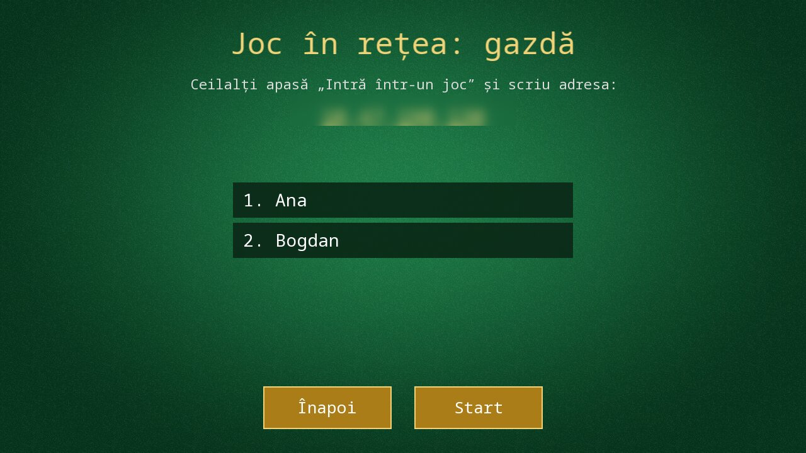
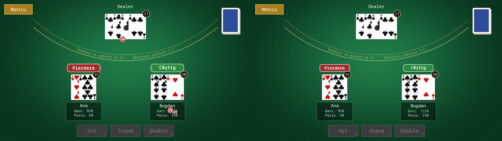
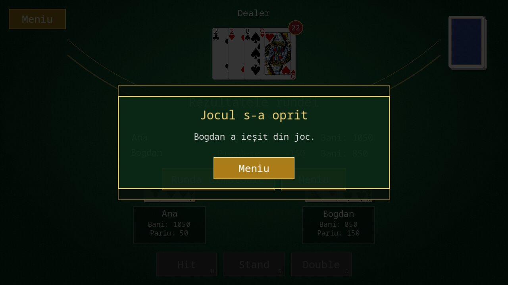

# Jocul în rețea

Doi, trei sau patru oameni joacă la aceeași masă, fiecare de pe calculatorul lui. Un
calculator e **gazda**: creează jocul și ține jocul real (Backend-ul). Ceilalți se conectează
la el, îi trimit ce aleg și primesc înapoi tot ce se întâmplă la masă.

Modul local („Joacă”, toți la același calculator) a rămas neschimbat.

## Cum se joacă

**Gazda**
1. Meniu → **Creează joc în rețea**.
2. Își scrie numele → **Creează**.
3. Pe ecran apare adresa calculatorului (ex. `192.168.1.5`). O spune celorlalți.
4. Când au intrat toți, apasă **Start**.

**Ceilalți**
1. Meniu → **Intră într-un joc**.
2. Își scriu numele și adresa gazdei → **Conectează-te** (Tab trece de la un câmp la altul,
   Enter în câmpul adresei conectează).
3. Văd lista jucătorilor și așteaptă ca gazda să apese Start.

| Lobby-ul gazdei | Lobby-ul unui jucător |
|---|---|
|  |  |

La masă, fiecare joacă doar pe locul lui: panoul de pariu și butoanele Hit / Stand / Double
apar doar când îi vine rândul. Cât timp e rândul altcuiva, masa scrie în mijloc pe cine
așteaptă. „Runda următoare” o poate apăsa oricine.

| Se așteaptă pariul gazdei | Aceeași rundă, la gazdă (stânga) și la jucător (dreapta) |
|---|---|
|  |  |

Dacă cineva închide jocul sau i se rupe legătura, jocul se oprește pentru toți, cu un mesaj
(„Bogdan a ieșit din joc.” / „Gazda a ieșit din joc.”) și butonul „Meniu”.



### Ce trebuie ca să meargă

- **Aceeași rețea** (același Wi-Fi sau cablu). Peste Internet ar trebui deschis portul în
  router sau folosit un VPN de tip Tailscale / ZeroTier; nu e testat.
- **Firewall-ul gazdei** trebuie să lase conexiunile pe portul **53000** (sau următoarele,
  până la 53009):
  - **Windows**: la prima creare a jocului apare fereastra Windows Defender → „Permite accesul”
    (pentru rețele private).
  - **Fedora**: `sudo firewall-cmd --add-port=53000-53009/tcp` (până la repornire; cu
    `--permanent` rămâne).
- Toți trebuie să aibă **aceeași versiune** a jocului; altfel gazda refuză conectarea.

**Portul.** Gazda folosește 53000. Dacă e ocupat (ex. jocul de adineauri, pe care sistemul îl
mai ține câteva zeci de secunde), ia următorul liber și îl afișează lângă adresă
(`192.168.1.5:53001`); atunci adresa se scrie la conectare exact așa, cu tot cu port.

## Cum funcționează

```
GAZDA                                                     JUCĂTOR
                                       rețea (TCP)
Game (Backend) ──anunțuri──▶ EventEncoder ═══════▶ ClientSession ──▶ RemoteGame ──anunțuri──▶ GameController ──▶ masa
     │     └──anunțuri──▶ GameController ──▶ masa                         │
     ▲                                                                    │
     └── HostSession ◀═══════ PlaceBet / Hit / Stand / DoubleDown / NextRound ◀── (butoanele mesei)
```

- **Gazda** rulează jocul real (`IGame::Produce()`). Ascultătorii lui sunt `GameController`
  (masa gazdei) și `EventEncoder`, care face din fiecare anunț un mesaj pentru rețea, cu starea
  jocului de după el (banii, pariurile, cărțile vizibile, scorurile).
- **La jucător**, `RemoteGame` **implementează `IGame`** și ține locul jocului real (patternul
  **Proxy**): `GameController` și masa lucrează cu el exact ca în jocul local. Acțiunile pleacă
  la gazdă; anunțurile primite sunt date mai departe ascultătorilor (**Observer**), iar
  întrebările (`GetPlayer(i)->GetScore()` etc.) primesc răspuns din ultima stare primită.
- Masa nu știe dacă jocul e local sau în rețea: primește un `GameSession` (`LocalSession`,
  `Net::HostSession` sau `Net::ClientSession`) și atât.

**Ce verifică gazda.** Acțiunile unui jucător trec doar dacă e rândul lui (sau, la pariu, dacă
lui i se cere pariul); restul (sume, reguli) îl verifică jocul, ca în modul local. Cartea cu
fața în jos a dealerului **nu pleacă** de pe calculatorul gazdei până nu se întoarce, deci nu
poate fi aflată din rețea. Mesajele primite sunt verificate (tipuri, valori, lungimi), iar
unul stricat e ignorat.

### Mesajele

Fiecare mesaj e un `sf::Packet` care începe cu tipul lui (`net/protocol.h`).

| De la → la | Mesaj | Conține |
|---|---|---|
| jucător → gazdă | `Join` | versiunea protocolului, numele |
| | `PlaceBet` | suma |
| | `Hit`, `Stand`, `DoubleDown`, `NextRound` | – |
| gazdă → jucător | `Rejected` | motivul (nume luat, masă plină, altă versiune) |
| | `PlayerList` | numele din lobby, în ordinea locurilor |
| | `GameStarting` | locul jucătorului, numele tuturor |
| | `GameEvent` | anunțul jocului (`IGameListener`) și starea de după el |
| | `GameOver` | – (nimeni nu mai are bani de pariu) |
| | `PlayerLeft` | numele celui care a ieșit |

### Fișierele

| Fișier | Ce face |
|---|---|
| `net/protocol.h` | Portul, tipurile de mesaje, citirea/scrierea cărților și a enum-urilor, trimiterea sigură |
| `net/game_snapshot.h` | Starea jocului care însoțește fiecare anunț; `PlayerSnapshot` implementează `IPlayer` |
| `net/game_events.h` | `EventEncoder` (anunț → mesaj, la gazdă) și `decodeEvent` (mesaj → anunț, la jucător) |
| `net/remote_game.h` | `RemoteGame`: `IGame` pentru jucătorul din rețea |
| `net/host_session.h` | Masa gazdei: jocul real + jucătorii din rețea |
| `net/client_session.h` | Masa jucătorului: `RemoteGame` + legătura cu gazda |
| `screens/host_lobby_screen.h` | Lobby-ul gazdei: așteaptă conexiuni, verifică numele, pornește jocul |
| `screens/join_lobby_screen.h` | Lobby-ul jucătorului: conectarea și așteptarea |
| `game/game_session.h`, `game/local_session.h` | De unde vine jocul pentru masă |

Rețeaua folosește modulul `sfml-network` din SFML (pornit în `cmake/Dependencies.cmake`).

## Limitări

- Fără reconectare: dacă pică cineva, jocul se oprește pentru toți.
- Câte un jucător pe calculator (gazda inclusiv); maxim 4 calculatoare.
- Nu se mai poate intra după Start.
- Testat pe Linux, cu două jocuri deschise pe același calculator (adresa `127.0.0.1`), plus
  un test automat care trece 1700+ anunțuri prin împachetare/despachetare și compară starea
  văzută de jucător cu jocul real. **Netestat încă între două calculatoare diferite și pe
  Windows.**
