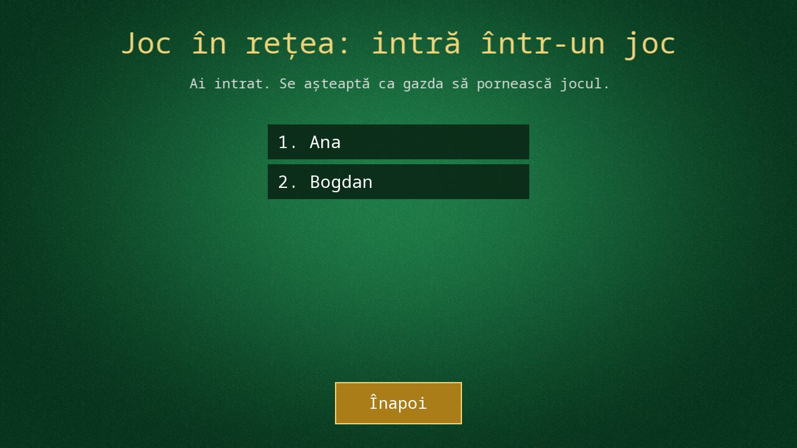
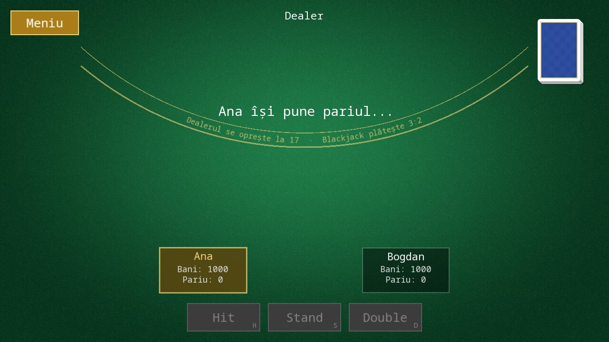

# Jocul în rețea

Doi, trei sau patru oameni joacă la aceeași masă, fiecare de pe calculatorul lui. Un
calculator e **gazda**: creează jocul și ține jocul real (Backend-ul). Ceilalți se conectează
la el, îi trimit ce aleg și primesc înapoi tot ce se întâmplă la masă.

Modul local („Joacă”, toți la același calculator) a rămas neschimbat.

## Cum se joacă

**Gazda**
1. Meniu → **Creează joc în rețea**.
2. Își scrie numele → **Creează**.
3. Pe ecran apare adresa calculatorului (ex. `192.168.1.5`). O spune celorlalți.
4. Când au intrat toți, apasă **Start**.

**Ceilalți**
1. Meniu → **Intră într-un joc**.
2. Își scriu numele și adresa gazdei → **Conectează-te** (Tab trece de la un câmp la altul,
   Enter în câmpul adresei conectează).
3. Văd lista jucătorilor și așteaptă ca gazda să apese Start.

| Lobby-ul gazdei | Lobby-ul unui jucător |
|---|---|
|  |  |

La masă, fiecare joacă doar pe locul lui: panoul de pariu și butoanele Hit / Stand / Double
apar doar când îi vine rândul. Cât timp e rândul altcuiva, masa scrie în mijloc pe cine
așteaptă. „Runda următoare” o poate apăsa oricine.

| Se așteaptă pariul gazdei | Aceeași rundă, la gazdă (stânga) și la jucător (dreapta) |
|---|---|
|  |  |

Dacă cineva închide jocul sau i se rupe legătura, jocul se oprește pentru toți, cu un mesaj
(„Bogdan a ieșit din joc.” / „Gazda a ieșit din joc.”) și butonul „Meniu”.


### Ce trebuie ca să meargă

- **Aceeași rețea** (același Wi-Fi sau cablu). Peste Internet ar trebui deschis portul în
  router sau folosit un VPN de tip Tailscale / ZeroTier; nu e testat.
- **Firewall-ul gazdei** trebuie să lase conexiunile pe portul **53000** (sau următoarele,
  până la 53009):
  - **Windows**: la prima creare a jocului apare fereastra Windows Defender → „Permite accesul”
    (pentru rețele private).
  - **Fedora**: `sudo firewall-cmd --add-port=53000-53009/tcp` (până la repornire; cu
    `--permanent` rămâne).
- Toți trebuie să aibă **aceeași versiune** a jocului; altfel gazda refuză conectarea.

**Portul.** Gazda folosește 53000. Dacă e ocupat (ex. jocul de adineauri, pe care sistemul îl
mai ține câteva zeci de secunde), ia următorul liber și îl afișează lângă adresă
(`192.168.1.5:53001`); atunci adresa se scrie la conectare exact așa, cu tot cu port.

## Cum funcționează

Toată rețeaua e în **Backend** (`game/Backend`, folderul `net/`), lângă logica jocului, și se
folosește printr-un API ca al jocului: interfețe, enum-uri și Observer. Frontend-ul nu are cod
de rețea: ecranele de lobby doar arată ce anunță Backend-ul, iar la masă jocul din rețea are
aceeași interfață `IGame` ca jocul local.

```
GAZDA (Backend)                                               JUCĂTOR (Backend)
                                          rețea (TCP)
Game ──anunțuri──▶ EventEncoder ═════════════════════▶ NetworkClient ──▶ RemoteGame ──anunțuri──▶ GameController ──▶ masa
  │  └──anunțuri──▶ GameController ──▶ masa (Frontend)                         │                     (Frontend)
  ▲                                                                            │
  └── NetworkHost ◀══════ PlaceBet / Hit / Stand / DoubleDown / NextRound ◀────┘ (butoanele mesei)
```

### API-ul (`game/Backend/include/Backend/`)

| Fișier | Ce e |
|---|---|
| `INetworkHost.h` | Gazda: `Produce(nume)`, `GetAddress()`, `CanStartGame()`, `StartGame()` |
| `INetworkClient.h` | Jucătorul: `Produce(adresă, nume, rezultat)` |
| `INetworkSession.h` | Ce au amândouă: `Update()`, `GetPlayerNames()`, `GetLocalSeat()`, `GetGame()`, `AddListener()` |
| `INetworkListener.h` | Observer: `OnPlayersChanged`, `OnJoinRejected`, `OnGameStarted`, `OnGameOver`, `OnPlayerLeft`, `OnHostLeft` |
| `NetworkEnums.h` | `EConnectResult` (de ce n-a mers conectarea), `EJoinRejection` (de ce a refuzat gazda) |

Nu folosește fire de execuție: `Update()` citește ce a venit din rețea și anunță ascultătorii,
deci Frontend-ul o apelează la fiecare frame.

**Pornirea jocului.** Gazda apelează `StartGame()`; toți primesc `OnGameStarted`, după care
își pun ascultătorii pe `GetGame()` (ca la jocul local), iar gazda pornește prima rundă cu
`GetGame()->StartRound()`.

### Patternuri

- **Proxy:** `RemoteGame` implementează `IGame` pe calculatorul jucătorului și ține locul
  jocului gazdei. Acțiunile pleacă la gazdă; anunțurile primite sunt date mai departe
  ascultătorilor; întrebările (`GetPlayer(i)->GetScore()` etc.) primesc răspuns din ultima
  stare primită.
- **Observer:** `EventEncoder` e un `IGameListener` al jocului real și trimite fiecare anunț în
  rețea; `INetworkListener` anunță Frontend-ul ce se întâmplă în afara mesei.
- **Decorator:** `HostedGame` e jocul real al gazdei, cu un singur lucru în plus: când
  `StartRound` e refuzat (nimeni nu mai are bani), anunță și jucătorii din rețea.

**Ce verifică gazda.** Cine intră (versiune, loc la masă, nume valid și nefolosit) și, în
timpul jocului, că un jucător acționează doar pe locul lui și doar când e rândul lui; restul
(sume, reguli) îl verifică jocul, ca în modul local. Cartea cu fața în jos a dealerului **nu
pleacă** de pe calculatorul gazdei până nu se întoarce. Mesajele primite sunt verificate
(tipuri, valori, lungimi), iar unul stricat e ignorat.

### Mesajele

Fiecare mesaj e un `sf::Packet` care începe cu tipul lui (`net/protocol.h`).

| De la → la | Mesaj | Conține |
|---|---|---|
| jucător → gazdă | `Join` | versiunea protocolului, numele |
| | `PlaceBet` | suma |
| | `Hit`, `Stand`, `DoubleDown`, `NextRound` | – |
| gazdă → jucător | `Rejected` | `EJoinRejection` |
| | `PlayerList` | numele din lobby, în ordinea locurilor |
| | `GameStarting` | locul jucătorului, numele tuturor |
| | `GameEvent` | anunțul jocului (`IGameListener`) și starea de după el |
| | `GameOver` | – (nimeni nu mai are bani de pariu) |
| | `PlayerLeft` | numele celui care a ieșit |

### Fișierele

**Backend** (`game/Backend`, partea internă în `include/Backend/net/` și `src/net/`):

| Fișier | Ce face |
|---|---|
| `net/protocol.h` | Porturile, tipurile de mesaje, citirea/scrierea cărților, enum-urilor și adreselor, trimiterea sigură |
| `net/game_snapshot.h` | Starea jocului care însoțește fiecare anunț; `PlayerSnapshot` implementează `IPlayer` |
| `net/game_events.h` | `EventEncoder` (anunț → mesaj, la gazdă) și `DecodeEvent` (mesaj → anunț, la jucător) |
| `net/remote_game.h` | `RemoteGame` (Proxy): `IGame` pentru jucătorul din rețea |
| `net/hosted_game.h` | `HostedGame` (Decorator): jocul real al gazdei |
| `net/network_host.h` | `NetworkHost`: lobby-ul și jocul la gazdă |
| `net/network_client.h` | `NetworkClient`: legătura jucătorului cu gazda |
| `net/listener_list.h` | Lista de ascultători (`weak_ptr`) comună |

Backend-ul folosește modulul `sfml-network` din SFML (doar el; nimic grafic).

**Frontend** (`game/Frontend`): ecranele `screens/host_lobby_screen.h` și
`screens/join_lobby_screen.h`, plus `game/network_session.h` (leagă jocul din rețea de masă și
arată pe masă cine a ieșit) și `game/network_events.h` (ascultătorul `INetworkListener` al
ecranelor).

## Limitări

- Fără reconectare: dacă pică cineva, jocul se oprește pentru toți.
- Câte un jucător pe calculator (gazda inclusiv); maxim 4 calculatoare.
- Nu se mai poate intra după Start.
- Testat pe Linux: două jocuri deschise pe același calculator (adresa `127.0.0.1`) și un test
  automat al API-ului din Backend (gazdă + jucător prin rețea, runde jucate până la finalul
  jocului, compararea stării după fiecare acțiune, refuzuri, ieșirea unui jucător).
  **Netestat încă între două calculatoare diferite și pe Windows.**
