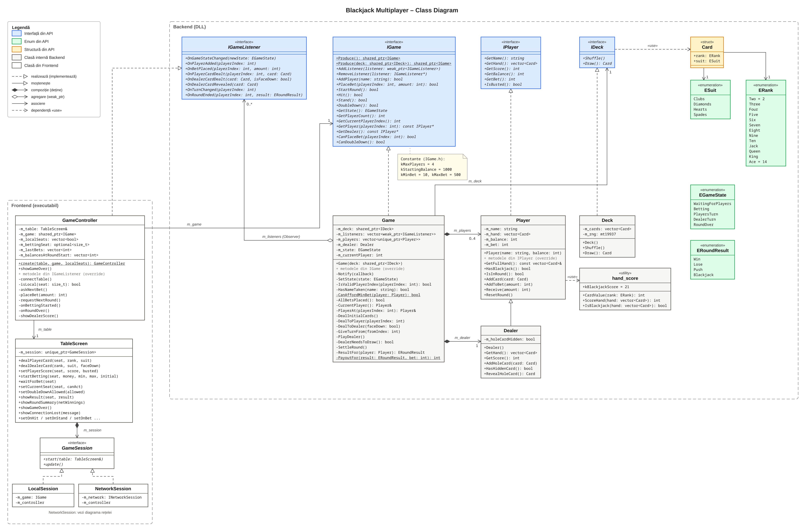

# Diagrame UML

## Use Case Diagram


Sursa e `use_case_diagram.svg`. Se poate modifica direct, ca text sau în Inkscape. PNG-ul se
regenerează cu:

```bash
magick -density 144 use_case_diagram.svg use_case_diagram.png
```

### Actori

- **Jucător**: un om care joacă. Jocul e multiplayer în două feluri: 1–4 jucători la același
  calculator, pe rând, sau 2–4 jucători în rețea, fiecare de pe calculatorul lui.
- **Gazdă**: jucătorul care creează jocul în rețea. E un caz particular de Jucător
  (generalizare: săgeata cu triunghi gol): poate face tot ce face un jucător, plus să creeze și
  să pornească jocul în rețea. Jocul real rulează pe calculatorul ei.
- **Dealerul** nu e actor, pentru că îl joacă sistemul automat. Apare ca un caz de utilizare
  intern, „Joacă tura dealerului”.

### Cazuri de utilizare ale jucătorului

| Caz | Unde în aplicație | Descriere |
|---|---|---|
| Începe un joc local | Meniu → „Joacă” | Deschide lobby-ul pentru jucătorii de la acest calculator. |
| Adaugă jucător | Lobby | Scrie un nume și îl adaugă. Numele trebuie să fie unic, iar la masă încap maxim 4 jucători. |
| Elimină jucător | Lobby → „X” | Scoate un jucător din listă. |
| Începe partida | Lobby → „Start” | Se așază la masă jucătorii din listă. Începe prima rundă. |
| Intră într-un joc în rețea | Meniu → „Intră într-un joc” | Scrie numele și adresa gazdei și se conectează; apoi așteaptă ca gazda să pornească jocul. La masă joacă doar pe locul lui. |
| Plasează pariul | Panoul de pariuri | Alege suma din jetoane și confirmă. Pariurile se pun pe rând. |
| Cere o carte (Hit) | Masă → Hit / H | Primește încă o carte. Peste 21, rândul trece mai departe. |
| Dublează pariul (Double) | Masă → Double / D | Doar cu primele 2 cărți. Dublează pariul, primește exact o carte, apoi rândul trece mai departe. |
| Stă (Stand) | Masă → Stand / S | Nu mai cere cărți; rândul trece la următorul jucător. |
| Vede rezultatele rundei | Ecranul de rezultat | Rezultatul fiecăruia, câștigul net și banii rămași. |
| Începe runda următoare | Ecranul de rezultat / Enter | Strânge cărțile și cere pariuri noi. |
| Revine la meniu | „Meniu” | Părăsește masa. |
| Oprește / pornește sunetul | Tasta M | Oriunde în aplicație. |
| Iese din joc | Meniu → „Ieșire” | Închide aplicația. |

### Cazuri de utilizare ale gazdei

| Caz | Unde în aplicație | Descriere |
|---|---|---|
| Creează joc în rețea | Meniu → „Creează joc în rețea” | Scrie numele și creează jocul; vede adresa pe care o spune celorlalți și lista celor care au intrat. |
| Pornește jocul în rețea | Lobby-ul gazdei → „Start” | Cu cel puțin încă un jucător intrat. Toți trec la masă. |

### Cazuri interne (le face sistemul)

| Caz | Relație | Descriere |
|---|---|---|
| Verifică cererea de intrare | «include» în Intră într-un joc în rețea | Gazda acceptă jucătorul doar dacă are aceeași versiune a jocului, mai e loc la masă și numele e bun și nefolosit. |
| Validează pariul | «include» în Plasează pariul | Pariul trebuie să fie între minim și maxim și să nu depășească banii jucătorului. |
| Împarte cărțile inițiale | «extend» la Plasează pariul | După pariul ultimului jucător: câte o carte fiecăruia, apoi dealerului, de două ori. A doua carte a dealerului e cu fața în jos. |
| Împarte o carte | «include» în Hit, Double, cărțile inițiale și tura dealerului | Scoate o carte din pachet și o dă cuiva. |
| Calculează scorul | «include» în Împarte o carte | J/Q/K valorează 10, iar asul 11 sau 1. |
| Joacă tura dealerului | «extend» la Stand și Double | După ultimul jucător: întoarce cartea ascunsă și trage până ajunge la 17 sau peste. |
| Stabilește rezultatele | «include» în tura dealerului | Câștig 1:1, blackjack 3:2, egal = pariul înapoi, pierdere. Actualizează banii. |

Notă: «include» înseamnă că se întâmplă de fiecare dată. «extend» înseamnă că se întâmplă doar
uneori, în condiția din nota de pe diagramă.

## Class Diagram



Sursa e `class_diagram.svg`. PNG-ul se regenerează la fel ca la Use Case:

```bash
magick -density 144 class_diagram.svg class_diagram.png
```

### Culori

| Culoare | Ce înseamnă | Elemente |
|---|---|---|
| Albastru | Interfață din API | `IGame`, `IGameListener`, `IPlayer`, `IDeck` |
| Verde | Enum din API | `ESuit`, `ERank`, `EGameState`, `ERoundResult` |
| Portocaliu | Structură din API | `Card` |
| Gri | Clasă internă din Backend (nu e în API) | `Game`, `Player`, `Dealer`, `Deck`, `hand_score` |
| Alb | Clasă din Frontend | `GameController`, `TableScreen` |

API-ul e tot ce vede Frontend-ul: fișierele din `game/Backend/include/Backend/` (fără
subfolderul `game/`). Clasele interne stau în `include/Backend/game/` și `src/game/` și se
creează doar prin `IGame::Produce()`.

### Relații importante

- **Observer:** `Game` ține o listă de `IGameListener` (`m_listeners`, ca `weak_ptr`) și le anunță
  fiecare schimbare (`OnPlayerCardDealt`, `OnTurnChanged`, `OnRoundEnded` etc.).
  `GameController` din Frontend implementează `IGameListener` și traduce anunțurile în
  funcții ale mesei (`TableScreen`).
- **Realizări:** `Game` implementează `IGame`, `Player` implementează `IPlayer`, `Deck`
  implementează `IDeck`. `Dealer` moștenește `Player` și ascunde a doua carte până o întoarce.
- **Compoziție:** `Game` deține jucătorii (0..4) și dealerul.
- **`IDeck`:** `Game` primește pachetul din afară (`IGame::Produce(deck)`), deci testele pot
  folosi un pachet cu cărțile într-o ordine cunoscută sau un mock.
- **`hand_score`:** funcții libere (nu o clasă) pentru scorul mâinii și blackjack.

Notație: metodele în *italic* sunt abstracte (pur virtuale), cele <u>subliniate</u> sunt
statice. „metodele din IGame (override)” ține locul metodelor din interfață, ca să nu fie
scrise de două ori.
