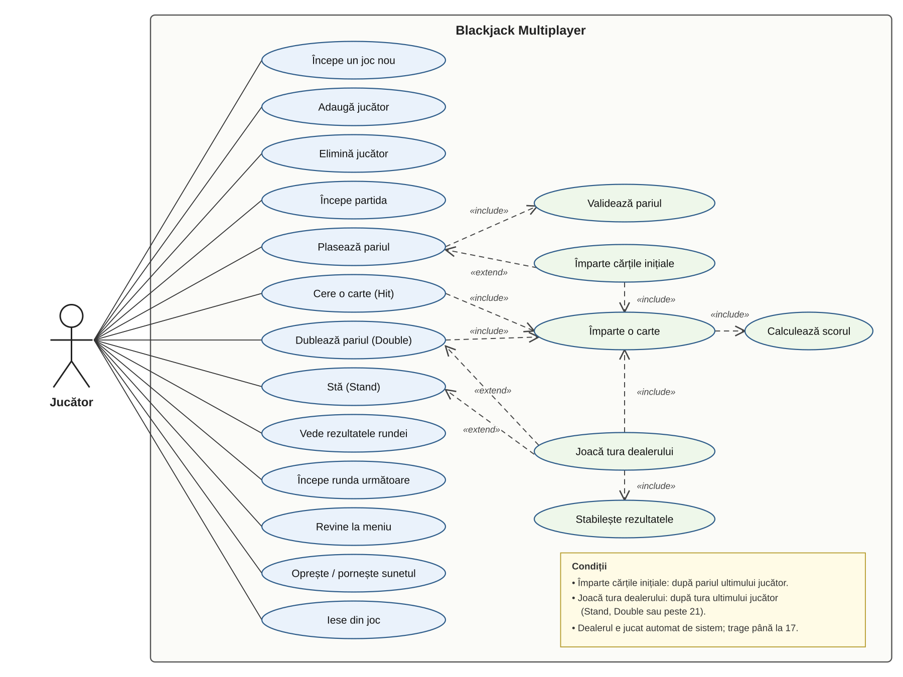

# Diagrame UML

## Use Case Diagram



Sursa e `use_case_diagram.svg`. Se poate modifica direct, ca text sau în Inkscape. PNG-ul se
regenerează cu:

```bash
magick -density 144 use_case_diagram.svg use_case_diagram.png
```

### Actori

- **Jucător**: omul de la calculator. Jocul e multiplayer pe același calculator (1–4 jucători),
  deci fiecare jucător folosește aceleași acțiuni când îi vine rândul.
- **Dealerul** nu e actor, pentru că îl joacă sistemul automat. Apare ca un caz de utilizare
  intern, „Joacă tura dealerului”.

### Cazuri de utilizare ale jucătorului

| Caz | Unde în aplicație | Descriere |
|---|---|---|
| Începe un joc nou | Meniu → „Joacă” | Deschide lobby-ul. |
| Adaugă jucător | Lobby | Scrie un nume și îl adaugă. Numele trebuie să fie unic, iar la masă încap maxim 4 jucători. |
| Elimină jucător | Lobby → „X” | Scoate un jucător din listă. |
| Începe partida | Lobby → „Start” | Se așază la masă jucătorii din listă. Începe prima rundă. |
| Plasează pariul | Panoul de pariuri | Alege suma din jetoane și confirmă. Pariurile se pun pe rând. |
| Cere o carte (Hit) | Masă → Hit / H | Primește încă o carte. Peste 21, rândul trece mai departe. |
| Dublează pariul (Double) | Masă → Double / D | Doar cu primele 2 cărți. Dublează pariul, primește exact o carte, apoi rândul trece mai departe. |
| Stă (Stand) | Masă → Stand / S | Nu mai cere cărți; rândul trece la următorul jucător. |
| Vede rezultatele rundei | Ecranul de rezultat | Rezultatul fiecăruia, câștigul net și banii rămași. |
| Începe runda următoare | Ecranul de rezultat / Enter | Strânge cărțile și cere pariuri noi. |
| Revine la meniu | „Meniu” | Părăsește masa. |
| Oprește / pornește sunetul | Tasta M | Oriunde în aplicație. |
| Iese din joc | Meniu → „Ieșire” | Închide aplicația. |

### Cazuri interne (le face sistemul)

| Caz | Relație | Descriere |
|---|---|---|
| Validează pariul | «include» în Plasează pariul | Pariul trebuie să fie între minim și maxim și să nu depășească banii jucătorului. |
| Împarte cărțile inițiale | «extend» la Plasează pariul | După pariul ultimului jucător: câte o carte fiecăruia, apoi dealerului, de două ori. A doua carte a dealerului e cu fața în jos. |
| Împarte o carte | «include» în Hit, Double, cărțile inițiale și tura dealerului | Scoate o carte din pachet și o dă cuiva. |
| Calculează scorul | «include» în Împarte o carte | J/Q/K valorează 10, iar asul 11 sau 1. |
| Joacă tura dealerului | «extend» la Stand și Double | După ultimul jucător: întoarce cartea ascunsă și trage până ajunge la 17 sau peste. |
| Stabilește rezultatele | «include» în tura dealerului | Câștig 1:1, blackjack 3:2, egal = pariul înapoi, pierdere. Actualizează banii. |

Notă: «include» înseamnă că se întâmplă de fiecare dată. «extend» înseamnă că se întâmplă doar
uneori, în condiția din nota de pe diagramă.

## Class Diagram (de făcut)

Se face după ce API-ul din Backend e stabil. Cerința cere ca interfețele, enum-urile și clasele
din API să fie evidențiate cu altă culoare, de exemplu:

- **interfețe** (`IGame`, `IGameListener`, `IPlayer`): o culoare;
- **enum-uri** (`ERank`, `ESuit`, `EGameState`, `ERoundResult`): altă culoare;
- **structuri din API** (`Card`): a treia culoare;
- clasele interne (implementarea jocului, Frontend-ul): neutru.
